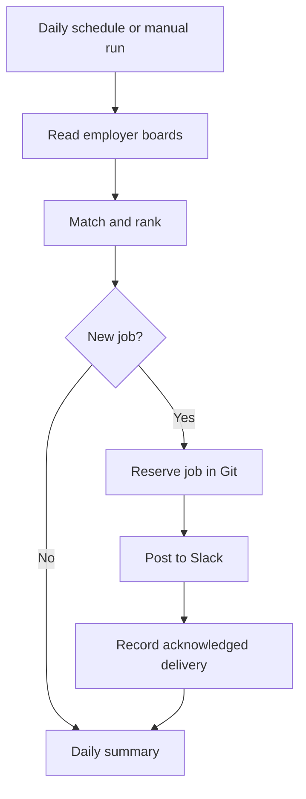

# Daily AI job alerts

Each morning GitHub starts a temporary Linux computer. Python reads public employer job listings and posts newly matched roles to the private Slack channel linked to the incoming webhook. ChatGPT helped write this project. The deployed workflow runs while your laptop is off.

## How a run works



A trigger is the event that starts a run. The cron expression `30 3 * * *` means every day at 03:30 UTC, or 09:00 IST. GitHub may start late or miss a run when busy. The next run scans the entire active inventory again. A posting removed between scans can be missed. The workflow also accepts a manual trigger. GitHub Actions provides the timer, computer, execution history and repository credentials in one service, so this setup needs no n8n server.

An API gives Python a structured answer to an HTTP request. Each board receives a read-only GET request and returns a list of job records as JSON. Ashby provides posting dates and work arrangements where supplied. Greenhouse supplies employer descriptions and locations. The code uses first publication dates when available. Edited dates do not establish publication dates. Job text is treated as data. The application button opens the employer's URL.

For example, a Bengaluru ML Engineer listing asking for 0–2 years reaches the ranking step. A remote listing restricted to the US drops out. A qualifying job already present in the ledger drops out too. If a board fails, other boards continue and the summary identifies the outage. If they all fail, the workflow reports a failure.

## Connect and deploy

1. The deployed project uses the public `ai-job-alerts` repository. For a new installation, create a repository. Put the contents of this project at the repository root on its default branch, including the hidden `.github` folder and initial empty ledger. A normal Git push includes these files. The workflow commits only ledger updates and needs permission to push to the default branch. If branch protection rejects these writes, the run fails before sending its first job.
2. In Slack, create a workspace app, enable Incoming Webhooks and select **Add New Webhook to Workspace**. Choose private **#ai-job-alerts** while signed in as a channel member. The webhook is restricted to the selected channel. GitHub uses this credential independently of your ChatGPT Slack connection.
3. In the repository open **Settings → Secrets and variables → Actions → Secrets → New repository secret**. Name it `SLACK_WEBHOOK_URL` and paste the webhook there. Never put it in the repository, an issue or a chat. GitHub passes this secret only to the send step. The temporary GitHub token persists the ledger.
4. Public repositories use the free standard Linux runner automatically. The rest of this step applies only to private repositories. Check the account's Actions billing and spending controls. For strict ₹0 use, confirm GitHub blocks paid overage, either because there is no payment method or because an applicable enforced spending limit blocks it. Leave billing off. After checking this, under **Actions → Variables** set repository variable `FREE_ACTIONS_CONFIRMED` to `true`. Until then GitHub skips the job before allocating its runner.
5. Open **Actions → AI job alerts → Run workflow**. Keep Preview checked first. Review the counts and source errors. Run again with Preview unchecked and check Slack for the accepted jobs or summary. The same workflow handles scheduled delivery.

GitHub Free currently includes $12 of monthly compute usage across the account. Standard two-core Linux costs $0.006 per minute. At the full ten-minute job timeout, 31 scheduled runs represent about $1.86 of included usage before any manual runs. Other repositories share the allowance. The project uploads no artifacts or caches. Slack Free permits up to ten apps and provides 90 days of accessible message history. No AI API or model subscription is used.

[GitHub billing](https://docs.github.com/en/billing/concepts/product-billing/github-actions) · [Slack Free limits](https://slack.com/help/articles/115002422943-Usage-limits-for-free-workspaces) · [Slack webhook setup](https://docs.slack.dev/messaging/sending-messages-using-incoming-webhooks/)

## Matching rules and coverage

Edit `settings.json` to add employer boards, topic names, skills or change the maximum required experience. A board entry contains the adapter (ashby or greenhouse), the employer's board slug and display name. Find the slug on the employer's official career page. The initial boards are Sarvam, Stripe and Razorpay. These cover the configured employers only. Every run reports which boards responded.

The title must mention a configured AI/ML topic and engineering or development, or a relevant internship with explicit conversion language. Senior and management titles are excluded. Location must identify Bengaluru/Bangalore or a remote role explicitly covering India or worldwide. Ambiguous remote locations drop out. Numeric experience requirements take priority over junior wording. A minimum of two years can qualify a candidate with exactly two years, including when a range extends higher. Listings without numeric requirements need explicit entry-level evidence. Rules can miss alternative phrasings and cannot verify every hiring restriction.

| Score component | Points |
| --- | --- |
| Target title | 30 |
| Eligible remote location / Bengaluru | 25 / 20 |
| Numeric experience evidence / early-career wording | 20 / 14 |
| Configured skills mentioned | 2 each, up to 10 |
| Posted within 72 hours / seven days / older or unknown | 10 / 5 / 0 |
| Employer-controlled board | 5 |

The score orders matches by rule. It does not estimate the likelihood of getting hired. Skill mentions can include preferred skills.

## Delivery, monitoring and recovery

A stable hash of the provider, employer board and job ID identifies each posting across runs. Git stores only these hashes and their delivery status. Separate requisitions and reposts with new IDs can appear again. A single concurrency group serializes runs. Before posting an alert the workflow pushes a pending reservation. After Slack returns HTTP success and the body `ok`, it pushes a sent receipt. If a crash or timeout makes acceptance uncertain, the reservation prevents automatic replay. Future runs surface pending reviews until resolved.

To review a pending hash, use a preview run and the diagnostic command below to correlate the hash with an active posting, then check the channel. Change its value to `sent` if received, or remove that single key to retry after verifying absence. Commit the changed ledger. If the posting has closed, use the historical workflow log and Slack timestamp. Avoid resetting the whole ledger.

On Windows or Android, open the repository in your browser and select **Actions → AI job alerts**. The newest green run indicates the last success. Open an individual run for the summary and individual steps. A manual preview sends zero messages. Real runs send one status summary even on zero-match days. Partial source outages appear in that summary. If Slack fails, GitHub retains the failure. A grey skipped run typically indicates the cost guard or branch condition. If no run appears around 09:00 IST, verify the file is on the default branch and Actions is enabled, then trigger a manual run.

## Local checks

From the project folder, run these commands using Python 3.11 or newer. The program uses only the standard library.

```sh
python -m unittest discover -s tests -v
python alerts.py
python alerts.py --list-matches
```

The default run is a dry run against live sources and requires internet access. The list option prints IDs and titles for diagnosis. Live delivery requires the repository secret and a writable Git checkout with an upstream branch. Read-only requests use a 15-second timeout and bounded exponential retries. Slack posts retry only explicit rate limits to avoid replaying an ambiguous delivery.

[Ashby job postings API](https://developers.ashbyhq.com/docs/public-job-posting-api) · [Greenhouse job board API](https://developers.greenhouse.io/job-board.html)
